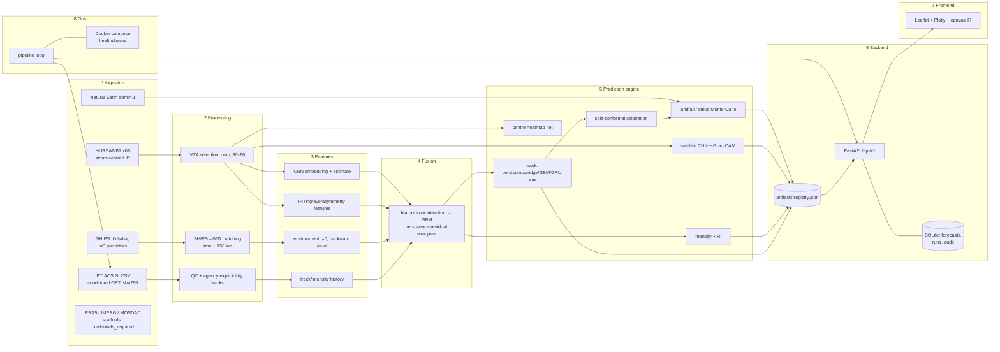
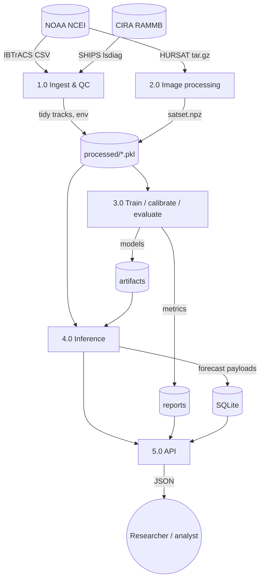
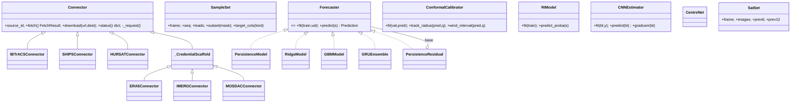
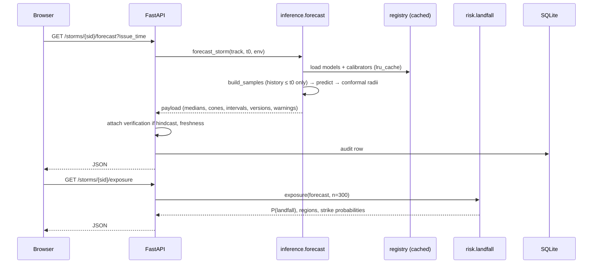

# Architecture (Phase 3: system design, as built in v0.2)

## 1. Layered view


## 2. Data-flow diagram (level 1)


## 3. UML: main classes


## 4. Sequence: forecast request


## 5. Sequence: real-time cycle
```mermaid
sequenceDiagram
  participant P as pipeline.run_once
  participant C as connectors
  participant B as datasets.build
  participant F as forecast
  participant S as SQLite
  P->>C: fetch IBTrACS (If-Modified-Since); status of others
  C-->>P: ok / not_modified / error (recorded, never raised)
  P->>B: build_processed() (cached by raw sha + config hash)
  P->>P: active_storms(): last obs ≤ 72 h of newest data AND not ancient
  loop each active storm
    P->>F: forecast_storm(track, env)
    F-->>P: payload or error (isolated)
    P->>S: save_forecast(+freshness)
  end
  P->>S: record_run(duration, ok|partial, details)
```

## 6. Database (SQLite; schema portable to PostgreSQL/PostGIS)
```mermaid
erDiagram
  forecasts { int id PK; text sid; text issue_time; text processed_at; text track_model; text intensity_model; text data_version; text source; json payload }
  pipeline_runs { int id PK; text started_at; text finished_at; real duration_s; text status; json details }
  audit_log { int id PK; text at; text endpoint; text sid; text issue_time; text model_version; text data_version; real duration_ms; text status; text error }
```
Constraint: `UNIQUE(sid, issue_time, track_model)` on forecasts makes re-runs idempotent.

## 7. Dashboard wireframe
```
┌──────────────────────────────────────────────────────────────────────────────────────┐
│ ◎ Tropicast   Bay of Bengal · Arabian Sea                              [API ok v0.2] │
├──────────────────────────────────────────────────────────────────────────────────────┤
│ EXPERIMENTAL. Not an official warning … follow IMD …                    IMD site ↗   │
├───────────────┬───────────────────────────────────────┬──────────────────────────────┤
│[Active|Explor-│                                       │ NAME  SID   [BEST TRACK][arch]│
│ er|Models|Data│        Leaflet map (dark)             │ observed / agencies / version │
│               │   — best track (IMD colours)          │ ┌ intensity chart ──────────┐ │
│ search …      │   - - provisional                     │ │ obs ─  AI ···  90% band   │ │
│ 1990–2026 ≥34 │   ··· AI median   ◯ 67% cones         │ └───────────────────────────┘ │
│ ▸ AMPHAN SuCS │   ○ verifying positions               │ issue ◀──────●──▶ 18 May 12Z │
│ ▸ FANI   ESCS │                                       │ lead pos r67/90 wind[90%] IMD │
│ …             │ ┌legend──────────┐                    │ category probs · P(RI) · prov.│
│               │ │ D DD CS SCS …  │                    │ Coastal exposure: P(lf), bars │
│               │ └────────────────┘                    │ Satellite IR + Grad-CAM, CNN  │
└───────────────┴───────────────────────────────────────┴──────────────────────────────┘
```

## 8. Configuration schema
| file | keys |
|---|---|
| domain.yaml | `basin`, `bbox{lat_min,lat_max,lon_min,lon_max}`, `subbasins[]`, `primary_agency`, `synoptic_hours[]` |
| sources.yaml | `sources.<id>{name,status,url,url_verified,auth,format,temporal_resolution,licence,expected_latency_hours,stale_after_hours,notes}` |
| imd_categories.yaml | `agency`, `wind_averaging_minutes`, `categories[{code,name,min_kt,max_kt}]`, `rapid_intensification{threshold_kt,window_h}` |
| training.yaml | `seed`, `timestep_h`, `history_steps`, `lead_times_h[]`, `min_wind_kt`, `split{train,val,test}`, `quantiles[]`, `gru{…}` |

## 9. Error handling, security and versioning
- **Errors:** connector retries with exponential backoff on network errors, 429 and 5xx; the failure is recorded in
  the manifest and the last good file is kept. The pipeline isolates failures per source and per storm (`partial`
  status). The API returns 404/422/503 with a message and writes an audit row.
- **Security:** read-only public data; no user accounts; per-IP rate limit; allow-listed report names; all API
  strings HTML-escaped in the UI; secrets only via environment or credential files (never committed); the container
  runs as a non-root user.
- **Data versioning:** `data_version` (raw sha + config hash), dataset manifest, per-source manifests.
- **Model versioning:** `<model>-<data_version>-<config_sha>-<UTC>` stored in the registry and in every payload.
  Rollback = repoint `registry.json`.

## 10. Deliberate deviations from the master prompt
| prompt default | v0.2 choice | reason |
|---|---|---|
| React | vanilla JS + Leaflet + Plotly (no build) | zero toolchain, served by the API; can be ported |
| PostgreSQL/PostGIS | SQLite | single file; spatial work is done in Python/shapely; schema portable |
| Celery/Redis | in-process loop + FastAPI background tasks | sources update on the scale of hours to days |
| MLflow | JSON registry + generated reports | one place to add MLflow logging (`training/pipeline.py`) |
| ERA5 | SHIPS developmental predictors | no CDS key; SHIPS is the operational predictor set |
| INSAT-3D/3DR | HURSAT-B1 | MOSDAC access pending; HURSAT is public and SID-keyed |
| attention / cross-attention fusion | concatenation (baseline) | the prompt asks for the baseline first; about 3.4k images is too few to justify more |
